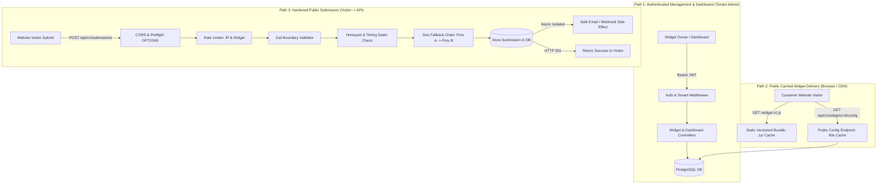
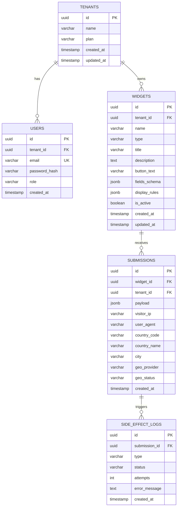
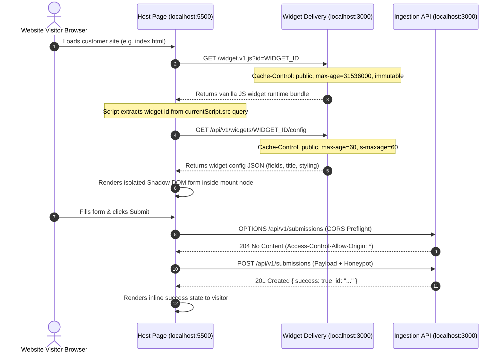
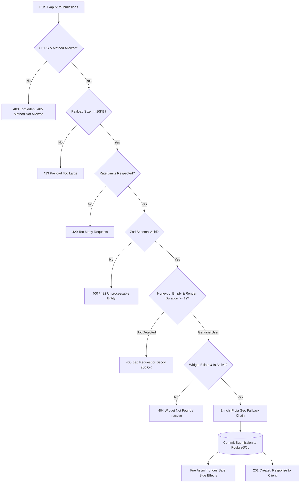
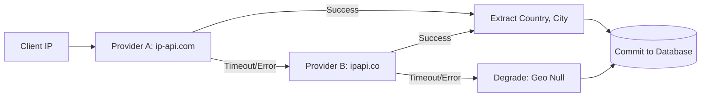

# FlyRank Embeddable Widget & Lead-Capture Platform — System Design Document

**Document Version:** 1.0.0  
**Status:** Approved for Implementation (Milestone 1 Gate)  
**Author:** Senior Backend Engineering Pair  
**Target Stack:** Node.js, Express.js, PostgreSQL 16 (Docker), plain HTML/JavaScript  

---

## Table of Contents
1. [Executive Summary & Problem Statement](#1-executive-summary--problem-statement)
2. [Explicit Non-Goals](#2-explicit-non-goals)
3. [Architecture Overview & Layered Decomposition](#3-architecture-overview--layered-decomposition)
4. [The Three Request Paths](#4-the-three-request-paths)
5. [Data Models & Persistence Strategy](#5-data-models--persistence-strategy)
6. [Multi-Tenant Isolation Strategy](#6-multi-tenant-isolation-strategy)
7. [The Embed Lifecycle & Delivery Architecture](#7-the-embed-lifecycle--delivery-architecture)
8. [Public Ingestion & Hardened Submission Pipeline](#8-public-ingestion--hardened-submission-pipeline)
9. [API Contracts & Interface Specifications](#9-api-contracts--interface-specifications)
10. [Boundary Validation & Security Hardening](#10-boundary-validation--security-hardening)
11. [Enrichment Fallback Chain & Safe Side Effects](#11-enrichment-fallback-chain--safe-side-effects)
12. [Dashboard Analytics & Aggregation Strategy](#12-dashboard-analytics--aggregation-strategy)
13. [Phased Implementation Plan](#13-phased-implementation-plan)

---

## 1. Executive Summary & Problem Statement

Modern web businesses rely on lightweight, embeddable micro-frontends (e.g., newsletter opt-ins, lead capture popovers, feedback forms) that their customers can install on third-party websites with a single HTML `<script>` tag. 

Unlike traditional private API architectures, an embeddable lead-capture platform operates directly on the untrusted, adversarial public internet:
1. **Unpredictable Origins:** Requests originate from browsers on disparate domains outside the API's administrative domain, demanding strict CORS and preflight handling.
2. **Untrusted Payloads:** Anyone with network access can probe endpoints with oversized, malformed, or malicious JSON bodies. Boundary validation must reject invalid data with standard `4xx` responses without triggering application exceptions (`500 Internal Server Error`).
3. **Abuse & Flood Attacks:** Public endpoints are natural targets for spam bots and denial-of-service volumetric bursts. Multi-tiered rate limiting and silent spam interception are required to safeguard availability.
4. **Unreliable Upstream Dependencies:** IP-to-geolocation providers and email notifications frequently experience network timeouts, rate limiting, or service degradation. The core business transaction—persisting a customer lead—must **never** fail due to secondary enrichment or notification failures ("Degrade, never fail").

This system delivers a multi-tenant backend engine that distributes cached embed code, serves dynamic widget configurations, ingests lead submissions cross-origin, and aggregates analytics for widget owners.

---

## 2. Explicit Non-Goals

To maintain rigorous focus on backend engineering excellence, resilience, and security, the following boundary is explicitly established:

> **Explicit Non-Goal:** **No Visual Drag-and-Drop Form Builder / WYSIWYG Designer.**  
> The platform will not implement a visual canvas, drag-and-drop form editor, or dynamic CSS theme styler. Widget layout and configuration are driven strictly through structured declarative JSON schemas via the authenticated API. The client-side widget loader renders minimal, clean semantic HTML. We are building a hardened backend infrastructure and delivery engine, not a form-builder startup.

Additional secondary non-goals:
- **No Global Anycast CDN Infrastructure:** Asset caching is designed according to HTTP standards (`Cache-Control`, `ETag`, `immutable`), proven via browser and reverse-proxy caches without requiring commercial third-party CDN contracts.
- **No Paid Third-Party SaaS Gateways:** Geolocation and email side effects operate entirely within the $0 stack (free public geo APIs with fallback mocks, and local Mailpit/console output).

---

## 3. Architecture Overview & Layered Decomposition

The system adheres to a strict 4-tier layered architecture separating HTTP routing, domain business logic, data persistence, and asynchronous worker tasks:

```
┌─────────────────────────────────────────────────────────────────────────────┐
│                           PRESENTATION LAYER (HTTP)                         │
│  - Express.js Router                                                        │
│  - CORS Middleware (Preflight OPTIONS, Origin Whitelist)                   │
│  - Two-Tier Rate Limiting Middleware (Global IP + Per-Widget IP)            │
│  - Payload Size Limiter (10kb body parser guard)                            │
│  - JWT Bearer Authentication Middleware                                     │
│  - Zod Request Schema Validation at the boundary                            │
└──────────────────────────────────────┬──────────────────────────────────────┘
                                       │
                                       ▼
┌─────────────────────────────────────────────────────────────────────────────┐
│                           APPLICATION / DOMAIN SERVICE                      │
│  - WidgetService (CRUD, Tenant ownership validation, Snippet generation)    │
│  - DeliveryService (Bundle delivery, Config caching, ETag negotiation)      │
│  - IngestionService (Spam detection, Geo-fallback chain, DB commit)        │
│  - DashboardService (Timeseries metrics, Conversion aggregations, Geo stats)│
└───────────────────┬──────────────────────────────────────┬──────────────────┘
                    │                                      │
                    ▼                                      ▼
┌──────────────────────────────────────────┐  ┌───────────────────────────────┐
│          PERSISTENCE LAYER (DATA)        │  │   ASYNC SIDE EFFECT WORKER    │
│  - PostgreSQL 16 (Docker)                │  │  - Isolated try/catch worker  │
│  - Tenant-Scoped Repositories            │  │  - Email dispatcher (Mailpit) │
│  - Composite Indexing & Foreign Keys     │  │  - Outbound Webhook client    │
│  - Safe Migrations & Seed Harness        │  │  - Graceful degradation logger│
└──────────────────────────────────────────┘  └───────────────────────────────┘
```

---

## 4. The Three Request Paths

To prevent cross-concern contamination, the platform isolates request handling into three distinct runtime paths:



1. **Path 1: Authenticated Widget Management & Owner Dashboard**
   - **Actor:** Authenticated Widget Owner.
   - **Security:** Strict JWT Bearer token authentication.
   - **Operations:** Widget CRUD, snippet generation, timeseries conversion analytics, geo breakdown.
   - **Tenancy:** Every database query enforces the authenticated `tenant_id`.

2. **Path 2: Public Cached Delivery**
   - **Actor:** Third-party browser rendering customer website.
   - **Security:** Public read-only; no sensitive tenant data exposed.
   - **Operations:** Serves static embed bundle (`/widget.v1.js`) with immutable cache headers, and serves runtime widget configurations (`/api/v1/widgets/:id/config`) with short TTL.

3. **Path 3: Public Submission Ingestion Pipeline**
   - **Actor:** Anonymous website visitors submitting form data.
   - **Security:** Cross-origin CORS with preflight handling, 10KB payload body ceiling, Zod validation, rate limiting, honeypot traps, and timing heuristics.
   - **Operations:** Resilient IP geolocation enrichment, relational persistence, and isolated secondary notifications.

---

## 5. Data Models & Persistence Strategy

The application stores data in PostgreSQL 16. Relational integrity, tenant foreign keys, and targeted composite indexes ensure scalability and isolation.

### 5.1 Database Entity Relationship



### 5.2 PostgreSQL DDL Specification

```sql
-- Enable UUID extension
CREATE EXTENSION IF NOT EXISTS "uuid-ossp";

-- 1. Tenants Table
CREATE TABLE tenants (
    id UUID PRIMARY KEY DEFAULT uuid_generate_v4(),
    name VARCHAR(255) NOT NULL,
    plan VARCHAR(50) NOT NULL DEFAULT 'standard',
    created_at TIMESTAMPTZ NOT NULL DEFAULT NOW(),
    updated_at TIMESTAMPTZ NOT NULL DEFAULT NOW()
);

-- 2. Users Table (Tenant Members)
CREATE TABLE users (
    id UUID PRIMARY KEY DEFAULT uuid_generate_v4(),
    tenant_id UUID NOT NULL REFERENCES tenants(id) ON DELETE CASCADE,
    email VARCHAR(255) UNIQUE NOT NULL,
    password_hash VARCHAR(255) NOT NULL,
    role VARCHAR(50) NOT NULL DEFAULT 'owner',
    created_at TIMESTAMPTZ NOT NULL DEFAULT NOW()
);
CREATE INDEX idx_users_tenant ON users(tenant_id);

-- 3. Widgets Table
CREATE TABLE widgets (
    id UUID PRIMARY KEY DEFAULT uuid_generate_v4(),
    tenant_id UUID NOT NULL REFERENCES tenants(id) ON DELETE CASCADE,
    name VARCHAR(255) NOT NULL,
    type VARCHAR(50) NOT NULL DEFAULT 'signup_form', -- signup_form, cta, popover
    title VARCHAR(255) NOT NULL,
    description TEXT DEFAULT '',
    button_text VARCHAR(100) NOT NULL DEFAULT 'Submit',
    fields_schema JSONB NOT NULL DEFAULT '[
      {"name": "email", "type": "email", "label": "Email Address", "required": true},
      {"name": "name", "type": "text", "label": "Full Name", "required": false}
    ]'::jsonb,
    display_rules JSONB NOT NULL DEFAULT '{
      "position": "bottom-right",
      "theme_color": "#2563eb",
      "allowed_origins": ["*"]
    }'::jsonb,
    is_active BOOLEAN NOT NULL DEFAULT TRUE,
    created_at TIMESTAMPTZ NOT NULL DEFAULT NOW(),
    updated_at TIMESTAMPTZ NOT NULL DEFAULT NOW(),
    CONSTRAINT uq_widgets_tenant_id UNIQUE (tenant_id, id)
);
CREATE INDEX idx_widgets_tenant_active ON widgets(tenant_id, is_active);

-- 4. Submissions Table
CREATE TABLE submissions (
    id UUID PRIMARY KEY DEFAULT uuid_generate_v4(),
    widget_id UUID NOT NULL REFERENCES widgets(id) ON DELETE CASCADE,
    tenant_id UUID NOT NULL REFERENCES tenants(id) ON DELETE CASCADE,
    payload JSONB NOT NULL,
    visitor_ip VARCHAR(45) NOT NULL,
    user_agent TEXT,
    country_code VARCHAR(10),
    country_name VARCHAR(100),
    city VARCHAR(100),
    geo_provider VARCHAR(50), -- 'ip-api', 'ipapi.co', 'none'
    geo_status VARCHAR(50) NOT NULL DEFAULT 'pending', -- 'enriched', 'failed', 'skipped'
    created_at TIMESTAMPTZ NOT NULL DEFAULT NOW()
);

-- Targeted Composite Indexes for Query Performance & Isolation
CREATE INDEX idx_submissions_tenant_created ON submissions(tenant_id, created_at DESC);
CREATE INDEX idx_submissions_widget_created ON submissions(widget_id, created_at DESC);
CREATE INDEX idx_submissions_tenant_country ON submissions(tenant_id, country_code);

-- 5. Safe Side Effect Delivery Logs Table
CREATE TABLE side_effect_logs (
    id UUID PRIMARY KEY DEFAULT uuid_generate_v4(),
    submission_id UUID NOT NULL REFERENCES submissions(id) ON DELETE CASCADE,
    type VARCHAR(50) NOT NULL, -- 'email', 'webhook'
    status VARCHAR(50) NOT NULL, -- 'success', 'failed'
    attempts INT NOT NULL DEFAULT 1,
    error_message TEXT,
    created_at TIMESTAMPTZ NOT NULL DEFAULT NOW()
);
CREATE INDEX idx_side_effect_submission ON side_effect_logs(submission_id);
```

---

## 6. Multi-Tenant Isolation Strategy

Tenant isolation is guaranteed at three distinct defensive boundaries:

1. **Authentication Token Binding:**  
   Every authenticated JWT encodes `{ userId: UUID, tenantId: UUID, role: string }`.
2. **Repository Boundary Scoping:**  
   No database query accepts an arbitrary `id` alone. All mutation, retrieval, and aggregation queries strictly parameterize `tenant_id`:
   ```sql
   -- Correct Tenant-Scoped Query Pattern
   SELECT * FROM widgets WHERE id = $1 AND tenant_id = $2;
   UPDATE widgets SET title = $1 WHERE id = $2 AND tenant_id = $3;
   DELETE FROM widgets WHERE id = $1 AND tenant_id = $2;
   ```
3. **No Cross-Tenant Information Leaks:**  
   If Tenant A attempts to fetch or mutate an existing `widget_id` owned by Tenant B, the API returns `404 Not Found` (rather than `403 Forbidden`) to prevent resource enumeration attacks.
4. **Submissions Linkage:**  
   When a public visitor submits to `/api/v1/submissions`, the backend resolves the `widget_id` to verify active status and captures the widget's `tenant_id` server-side. The visitor never specifies `tenant_id`.

---

## 7. The Embed Lifecycle & Delivery Architecture

The customer integration experience requires zero external libraries or bundle managers:

```html
<!-- One-line customer integration -->
<script src="http://localhost:3000/widget.v1.js?id=e7b4010a-3d96-48c9-94b2-03d6d03d32cb" defer></script>
```

### 7.1 Embed Sequence Flow



### 7.2 Caching Header Semantics

| Resource | Route | Cache-Control Header | Invalidation Strategy |
| :--- | :--- | :--- | :--- |
| **Widget Engine Bundle** | `/widget.v1.js` | `public, max-age=31536000, immutable` | Versioned file naming (`.v1.js`, `.v2.js`). Releases never overwrite existing URLs. |
| **Widget Configuration** | `/api/v1/widgets/:id/config` | `public, max-age=60, s-maxage=60, stale-while-revalidate=120` | Dynamic TTL with 60s cache; updates propagate across the web in under a minute. |

---

## 8. Public Ingestion & Hardened Submission Pipeline

The public submission pipeline processes incoming requests through seven defensive filters:



---

## 9. API Contracts & Interface Specifications

All API payloads conform to strict JSON structures. Timestamps are formatted in ISO-8601 UTC.

### 9.1 Authentication Endpoints

#### `POST /api/v1/auth/register`
- **Access:** Public
- **Request Body:**
  ```json
  {
    "tenant_name": "Acme Corp",
    "email": "admin@acme.com",
    "password": "SecurePassword123!"
  }
  ```
- **Response `201 Created`:**
  ```json
  {
    "status": "success",
    "data": {
      "user_id": "c1f7b19a-9d3e-4b2a-89a1-7c9b8a3e4d5f",
      "tenant_id": "8d3e4b2a-c1f7-4b2a-89a1-0a1b2c3d4e5f",
      "email": "admin@acme.com",
      "token": "eyJhbGciOiJIUzI1NiIsInR5cCI6IkpXVCJ9..."
    }
  }
  ```

#### `POST /api/v1/auth/login`
- **Access:** Public
- **Request Body:**
  ```json
  {
    "email": "admin@acme.com",
    "password": "SecurePassword123!"
  }
  ```
- **Response `200 OK`:**
  ```json
  {
    "status": "success",
    "data": {
      "token": "eyJhbGciOiJIUzI1NiIsInR5cCI6IkpXVCJ9...",
      "tenant_id": "8d3e4b2a-c1f7-4b2a-89a1-0a1b2c3d4e5f"
    }
  }
  ```

---

### 9.2 Widget Management Endpoints (Authenticated)

All management routes require `Authorization: Bearer <token>`.

#### `GET /api/v1/widgets`
- **Access:** Tenant Authenticated
- **Response `200 OK`:**
  ```json
  {
    "status": "success",
    "data": [
      {
        "id": "e7b4010a-3d96-48c9-94b2-03d6d03d32cb",
        "name": "Homepage Newsletter",
        "type": "signup_form",
        "title": "Join our Newsletter",
        "description": "Weekly backend insights directly in your inbox.",
        "button_text": "Subscribe Now",
        "is_active": true,
        "submission_count": 142,
        "created_at": "2026-10-24T12:00:00.000Z"
      }
    ]
  }
  ```

#### `POST /api/v1/widgets`
- **Access:** Tenant Authenticated
- **Request Body:**
  ```json
  {
    "name": "Product Launch Waitlist",
    "type": "signup_form",
    "title": "Get Early Access",
    "description": "Be the first to test our API.",
    "button_text": "Request Invite",
    "fields_schema": [
      { "name": "email", "type": "email", "label": "Work Email", "required": true },
      { "name": "company", "type": "text", "label": "Company Name", "required": false }
    ],
    "display_rules": {
      "position": "bottom-right",
      "theme_color": "#0ea5e9",
      "allowed_origins": ["http://localhost:5500"]
    }
  }
  ```
- **Response `201 Created`:** Returns created widget object including generated embed snippet.

#### `GET /api/v1/widgets/:id/snippet`
- **Access:** Tenant Authenticated
- **Response `200 OK`:**
  ```json
  {
    "status": "success",
    "data": {
      "widget_id": "e7b4010a-3d96-48c9-94b2-03d6d03d32cb",
      "embed_snippet": "<script src=\"http://localhost:3000/widget.v1.js?id=e7b4010a-3d96-48c9-94b2-03d6d03d32cb\" defer></script>"
    }
  }
  ```

---

### 9.3 Public Delivery Endpoints

#### `GET /widget.v1.js`
- **Access:** Public
- **Headers:** `Cache-Control: public, max-age=31536000, immutable`
- **Response:** Vanilla JavaScript bundle (IIFE) that injects and manages the widget lifecycle.

#### `GET /api/v1/widgets/:id/config`
- **Access:** Public (CORS Enabled)
- **Headers:** `Cache-Control: public, max-age=60, s-maxage=60, stale-while-revalidate=120`
- **Response `200 OK`:**
  ```json
  {
    "id": "e7b4010a-3d96-48c9-94b2-03d6d03d32cb",
    "type": "signup_form",
    "title": "Get Early Access",
    "description": "Be the first to test our API.",
    "button_text": "Request Invite",
    "fields": [
      { "name": "email", "type": "email", "label": "Work Email", "required": true },
      { "name": "company", "type": "text", "label": "Company Name", "required": false }
    ],
    "display": {
      "position": "bottom-right",
      "theme_color": "#0ea5e9"
    }
  }
  ```

---

### 9.4 Public Submission Endpoint

#### `POST /api/v1/submissions`
- **Access:** Public (CORS Enabled, Preflight Handled)
- **Rate Limit:** 15 req/min per IP; 60 req/min per Widget ID
- **Max Payload Size:** 10KB
- **Request Body:**
  ```json
  {
    "widget_id": "e7b4010a-3d96-48c9-94b2-03d6d03d32cb",
    "payload": {
      "email": "visitor@example.com",
      "company": "Developer Studio"
    },
    "_hp_company": "",
    "_rendered_at": 1729780000000
  }
  ```
- **Response `201 Created`:**
  ```json
  {
    "status": "success",
    "message": "Submission recorded successfully",
    "data": {
      "submission_id": "9a3e4b2a-c1f7-4b2a-89a1-0a1b2c3d4e5f"
    }
  }
  ```
- **Error Responses:**
  - `400 Bad Request`: Validation failure or spam detected.
  - `413 Payload Too Large`: Payload exceeds 10KB ceiling.
  - `422 Unprocessable Entity`: Missing required form fields.
  - `429 Too Many Requests`: Rate limit exceeded.

---

### 9.5 Dashboard & Analytics Endpoints (Authenticated)

#### `GET /api/v1/dashboard/stats`
- **Access:** Tenant Authenticated
- **Query Params:** `widget_id` (optional), `timeframe` (`7d`, `30d`, default `7d`)
- **Response `200 OK`:**
  ```json
  {
    "status": "success",
    "data": {
      "total_submissions": 850,
      "unique_widgets_active": 4,
      "submissions_over_time": [
        { "date": "2026-10-18", "count": 110 },
        { "date": "2026-10-19", "count": 125 },
        { "date": "2026-10-20", "count": 140 }
      ]
    }
  }
  ```

#### `GET /api/v1/dashboard/geo`
- **Access:** Tenant Authenticated
- **Response `200 OK`:**
  ```json
  {
    "status": "success",
    "data": [
      { "country_code": "US", "country_name": "United States", "count": 450, "percentage": 52.9 },
      { "country_code": "DE", "country_name": "Germany", "count": 210, "percentage": 24.7 },
      { "country_code": "IN", "country_name": "India", "count": 190, "percentage": 22.4 }
    ]
  }
  ```

#### `GET /api/v1/dashboard/submissions`
- **Access:** Tenant Authenticated
- **Query Params:** `widget_id`, `page=1`, `limit=20`
- **Response `200 OK`:** Returns paginated submissions with IP, country, city, and form payload.

---

## 10. Boundary Validation & Security Hardening

### 10.1 Boundary Schema Validation (Zod)
Requests entering Express routes pass through strict Zod schemas before touching any domain logic:

```typescript
import { z } from 'zod';

export const SubmissionRequestSchema = z.object({
  widget_id: z.string().uuid({ message: "Invalid widget UUID format" }),
  payload: z.record(z.string(), z.any()).refine(
    (data) => Object.keys(data).length > 0,
    { message: "Payload must contain at least one field" }
  ),
  _hp_company: z.string().optional(), // Honeypot trap field
  _rendered_at: z.number().int().positive().optional() // Form render epoch ms
});
```

### 10.2 Payload Ceiling Guard
Payload size is bounded at the HTTP parser boundary:
```javascript
app.use(express.json({ limit: '10kb' }));
```
Any body exceeding 10KB triggers an immediate `413 Payload Too Large` JSON response via custom error middleware, preventing server memory consumption attacks.

### 10.3 CORS & Preflight OPTIONS
- Public routes (`/widget.v1.js`, `/api/v1/widgets/:id/config`, `/api/v1/submissions`) permit cross-origin invocation.
- Automatic browser preflight `OPTIONS /api/v1/submissions` responds with:
  ```http
  HTTP/1.1 204 No Content
  Access-Control-Allow-Origin: *
  Access-Control-Allow-Methods: POST, OPTIONS
  Access-Control-Allow-Headers: Content-Type, Accept
  Access-Control-Max-Age: 86400
  ```

### 10.4 Abuse Protection: Two-Tier Rate Limiting
1. **Tier 1: Global IP Limiter:** Limits requests across all widgets to 15 per minute per IP using `express-rate-limit`. Returns `429 Too Many Requests`.
2. **Tier 2: Per-Widget ID Limiter:** Ensures that even with bot-rotated IPs, no single widget can be spammed past 60 requests per minute.

### 10.5 Spam Prevention: Honeypot & Timing Heuristic
1. **Honeypot Field (`_hp_company`):** Injected into the form with CSS styling (`display: none !important; opacity: 0; position: absolute; left: -9999px;`). Real visitors never fill this input. If populated, the API rejects the request or silently drops it with a decoy response.
2. **Submission Timing Heuristic:** Human visitors take at least 1.5–3 seconds to read and submit a form. If `Date.now() - _rendered_at < 1000ms`, the submission is flagged as an automated script submission.

---

## 11. Enrichment Fallback Chain & Safe Side Effects

### 11.1 Geolocation Provider Fallback Chain
Lead submissions are enriched with visitor geolocation via a resilient fallback chain:



1. **Provider A (`ip-api.com`):** JSON endpoint, no API key required, 45 requests/minute. Timeout set to 1500ms.
2. **Provider B (`ipapi.co`):** Secondary fallback endpoint, ~1,000 lookups/day free. Timeout set to 1500ms.
3. **Graceful Degradation Guarantee:** If both providers fail or timeout, the transaction proceeds uninterrupted with `geo_status: 'failed'` and null coordinates. The submission **never** fails due to geolocation outages.
4. **Deterministic Testing Toggles:** Controlled via `.env` flags:
   - `MOCK_GEO_PROVIDER_A_FAIL=true`
   - `MOCK_GEO_PROVIDER_B_FAIL=true`

### 11.2 Safe Side Effects Architecture
Secondary side effects (sending owner notification emails via Mailpit or dispatching webhooks) are completely decoupled from primary persistence:

1. **Commit First:** The submission is committed to PostgreSQL in an atomic database transaction.
2. **Isolated Asynchronous Dispatch:**
   ```javascript
   // Safe Side Effect Pattern
   const submission = await submissionRepo.create(submissionData);

   // Isolated side effect execution (post-commit)
   setImmediate(async () => {
     try {
       await emailService.sendNotification(submission);
     } catch (err) {
       logger.warn(`[SafeSideEffect] Email notification failed for ${submission.id}:`, err.message);
       await auditRepo.logSideEffectFailure(submission.id, 'email', err.message);
     }
   });

   // Immediate 201 response to visitor
   return res.status(201).json({ status: 'success', id: submission.id });
   ```
3. **Outcome:** Even if SMTP is unreachable or webhooks timeout, the visitor receives `201 Created` and their lead is safely stored.

---

## 12. Dashboard Analytics & Aggregation Strategy

To ensure sub-100ms dashboard response times without complex data warehouse pipelines, aggregations leverage PostgreSQL's composite indexes:

### 12.1 Submissions Over Time Query
```sql
SELECT 
    DATE_TRUNC('day', created_at) AS date,
    COUNT(*) AS count
FROM submissions
WHERE tenant_id = $1 
  AND created_at >= NOW() - INTERVAL '30 days'
GROUP BY 1
ORDER BY 1 ASC;
```

### 12.2 Geographic Distribution Query
```sql
SELECT 
    COALESCE(country_code, 'Unknown') AS country_code,
    COALESCE(country_name, 'Unknown') AS country_name,
    COUNT(*) AS count,
    ROUND((COUNT(*) * 100.0 / NULLIF(SUM(COUNT(*)) OVER(), 0)), 1) AS percentage
FROM submissions
WHERE tenant_id = $1
GROUP BY country_code, country_name
ORDER BY count DESC
LIMIT 10;
```

---

## 13. Phased Implementation Plan

| Phase | Focus Area | Key Deliverables & Gates | Estimated Effort |
| :--- | :--- | :--- | :--- |
| **Phase 1: Design & Specification** | Documentation & Architecture | - Complete `DESIGN.md`, `README.md`, `BUILDLOG.md`, `EVIDENCE.md`<br>- Manifest `capstone.yaml`, `.env.example`, `.gitignore`<br>- **Gate:** One-page design doc committed with explicit non-goal. | 4–6 hrs (Milestone 1 Complete) |
| **Phase 2: Hardened Ingestion Path** | Persistence & Submission Engine | - Docker Compose setup with PostgreSQL 16 & migrations<br>- Auth (JWT) & Tenant-isolated Widget CRUD<br>- `POST /api/v1/submissions` with CORS, preflight, Zod validation<br>- Two-tier rate limiting + honeypot spam filter<br>- Geo fallback chain (`ip-api` -> `ipapi.co` -> null) with test mocks<br>- Safe side effects (Mailpit/console)<br>- **Gate:** Cross-origin curl stores an enriched row. | 14–20 hrs |
| **Phase 3: Delivery, Dashboard & Proof** | Embed Script, UI & Analytics | - Vanilla JS embed engine (`/widget.v1.js`) with Shadow DOM & long cache headers<br>- Config endpoint (`/api/v1/widgets/:id/config`) with 60s cache headers<br>- Second-origin test harness running on port 5500 (`index.html`)<br>- Dashboard stats & geo breakdown endpoints<br>- Minimal owner dashboard UI<br>- Automated test suite covering Section 13 Probes 1–6<br>- Populate all verification proofs into `EVIDENCE.md`<br>- **Gate:** Widget renders and submits from second-origin page. | 12–16 hrs |
