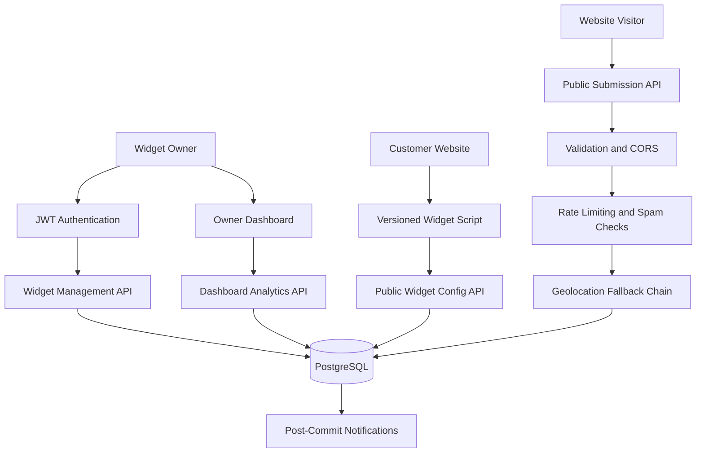

# FlyRank — Embeddable Widget & Lead-Capture Platform

A secure, multi-tenant backend platform that allows customers to create embeddable widgets, collect leads from external websites, protect submissions against abuse, enrich visitor data with geolocation, and analyze submissions through an owner dashboard.

Built with **Node.js, Express.js, PostgreSQL, and vanilla JavaScript** as a backend engineering capstone project.

## Overview

FlyRank enables a website owner to create a widget and embed it on another website using a JavaScript snippet. Visitors can submit information through the widget, and the platform securely validates, filters, enriches, stores, and exposes the submissions to the authorized widget owner.

The project demonstrates practical backend engineering concepts, including REST APIs, authentication, tenant isolation, cross-origin requests, caching, rate limiting, database migrations, asynchronous side effects, and automated testing.

## Features

### Widget Management
- Authenticated widget creation, retrieval, updating, and deletion.
- JWT-based authentication with password hashing.
- Tenant isolation to prevent customers from accessing each other's widgets and submissions.
- Validated widget schemas and configurable display options.
- Automatic embed snippet generation.

### Embeddable Widget Delivery
- Versioned JavaScript widget bundle.
- Shadow DOM encapsulation to isolate widget styles.
- Public configuration endpoint with short-lived caching.
- Long-lived immutable caching for the versioned JavaScript bundle.
- Accessible form controls and client-side validation.
- Cross-origin embedding on a separate customer website.

### Secure Lead Capture
- Public submission API with server-side validation.
- CORS support, including preflight requests.
- Request payload size limits.
- Per-IP and per-widget rate limiting.
- Honeypot and submission-timing checks.
- Parameterized SQL queries.
- Consistent JSON error responses.

### Geolocation and Resilience
- IP-based geolocation enrichment using a provider fallback chain.
- Secondary provider attempted when the primary provider fails.
- Graceful degradation when geolocation providers are unavailable.
- Post-commit email/webhook side effects designed not to block successful submissions.
- Side-effect logging for troubleshooting.

### Owner Dashboard
- Authenticated dashboard APIs.
- Paginated and searchable submission records.
- Submission volume analytics.
- Geographic distribution and percentages.
- Active widget counts.
- Dashboard login, loading, empty, and error states.

### Testing and Verification
- Automated API and integration tests.
- Authentication and tenant-isolation tests.
- Submission validation and abuse-protection tests.
- Geolocation fallback and side-effect failure tests.
- Cross-origin integration verification.
- Playwright desktop-browser verification.

## Architecture

The application separates HTTP routing, controllers, business logic, validation, and database access.



### Request Flow

1. A customer registers and authenticates.
2. The customer creates a widget through the authenticated API.
3. FlyRank returns an embeddable JavaScript snippet.
4. An external website loads the widget script and public widget configuration.
5. A visitor submits the form.
6. The backend validates the request, applies abuse controls, attempts geolocation enrichment, and stores the submission.
7. Notification side effects run after the primary submission is committed.
8. The authorized widget owner views submissions and analytics through the dashboard.

## Technology Stack

| Component | Technology |
|---|---|
| Runtime | Node.js |
| Backend framework | Express.js |
| Database | PostgreSQL |
| Database access | `pg` |
| Request validation | Zod |
| Authentication | JSON Web Tokens (JWT) |
| Password hashing | bcryptjs |
| Frontend | HTML, CSS, vanilla JavaScript |
| Widget isolation | Shadow DOM |
| Testing | Node.js test runner, Supertest, JSDOM, Playwright |
| Local services | PostgreSQL; optional Docker Compose and Mailpit configuration |

## Project Structure

```text
Capstone/
├── src/
│   ├── config/          # Environment configuration
│   ├── controllers/     # HTTP controllers
│   ├── db/              # Database access, migrations and seeds
│   │   └── migrations/
│   ├── middleware/      # Authentication, validation and protections
│   ├── public/
│   │   ├── dashboard/  # Owner dashboard interface
│   │   └── widget.v1.js
│   ├── routes/          # API routes
│   ├── services/        # Business logic and integrations
│   ├── validators/      # Zod schemas
│   ├── app.js
│   └── server.js
├── scripts/             # Database, demo-site and verification scripts
├── test-site/           # Second-origin customer demo page
├── tests/               # Automated test suites
├── screenshots/         # Browser verification screenshots
├── .env.example         # Safe environment template
├── .gitignore
├── BUILDLOG.md
├── DESIGN.md
├── EVIDENCE.md
├── MANUAL_QA.md
├── capstone.yaml
├── docker-compose.yml
├── package.json
└── README.md
```

## Getting Started

### Prerequisites

Install the following before running the project:

- Node.js and npm.
- PostgreSQL, or a supported Docker-based PostgreSQL setup.
- Git, if cloning the repository.

The application and customer demo site run locally on separate ports. No production domain, CDN, or paid hosting is required for local verification.

### 1. Clone the Repository

```bash
git clone https://github.com/YOUR_USERNAME/flyrank-embeddable-widget.git
cd flyrank-embeddable-widget
```

Replace `YOUR_USERNAME` with the GitHub account that owns the repository.

### 2. Install Dependencies

```bash
npm install
```

### 3. Configure Environment Variables

Create your local environment file from the template.

PowerShell:

```powershell
Copy-Item .env.example .env
```

Open `.env` and configure the PostgreSQL connection and a strong, unique JWT secret. Never commit `.env` or publish real credentials.

Review `.env.example` for the supported configuration options, including server settings, database access, CORS origins, rate limits, geolocation providers, and notification settings.

### 4. Start PostgreSQL

Use a locally installed PostgreSQL instance or the supported database startup script.

For the project's configured local database scripts, inspect `package.json` and run the appropriate command, for example:

```bash
npm run db:start
```

Alternatively, if using the included Docker Compose configuration and Docker is installed:

```bash
docker compose up -d
```

Make sure the database connection values in `.env` match the database instance you started.

### 5. Run Database Migrations and Seed Data

Apply the database schema migrations before starting the application. Then seed development data.

```bash
npm run migrate
npm run seed
```

The seed command is intended for development and local verification. Do not use development seed accounts or credentials in a production environment.

### 6. Start the API Server

```bash
npm run dev
```

The API server is expected to be available at:

```text
http://localhost:3000
```

Check the health endpoint:

```text
http://localhost:3000/health
```

### 7. Start the Second-Origin Customer Website

Open another terminal in the project directory:

```bash
npm run test-site
```

Visit:

```text
http://localhost:5500
```

The customer page loads the embeddable widget from the API server on port 3000. This demonstrates cross-origin widget delivery and submission without requiring an externally hosted website.

### 8. Open the Owner Dashboard

Visit:

```text
http://localhost:3000/dashboard
```

Sign in using a locally configured development account. If necessary, register a tenant using the authentication API or seed development data.

Create a widget, submit a test lead from the customer website, and verify that the submission appears in the dashboard.

> **Note:** The exact package scripts and database prerequisites should be checked against `package.json` and the current local environment if your setup differs.

## API Documentation

Base URL:

```text
http://localhost:3000
```

### Health

| Method | Endpoint | Description |
|---|---|---|
| GET | `/health` | Application and database health status |

### Authentication

| Method | Endpoint | Authentication | Description |
|---|---|---|---|
| POST | `/api/v1/auth/register` | Public | Register a tenant and user |
| POST | `/api/v1/auth/login` | Public | Authenticate and receive a JWT |

Authenticated requests use the bearer-token header:

```http
Authorization: Bearer YOUR_JWT_TOKEN
```

### Widget Management

| Method | Endpoint | Authentication | Description |
|---|---|---|---|
| GET | `/api/v1/widgets` | Required | List the authenticated tenant's widgets |
| POST | `/api/v1/widgets` | Required | Create a widget |
| GET | `/api/v1/widgets/:id` | Required | Retrieve a widget |
| PUT | `/api/v1/widgets/:id` | Required | Update a widget |
| DELETE | `/api/v1/widgets/:id` | Required | Delete a widget |
| GET | `/api/v1/widgets/:id/snippet` | Required | Retrieve the embed snippet |
| GET | `/api/v1/widgets/:id/config` | Public | Retrieve safe public widget configuration |

### Public Widget Delivery and Submissions

| Method | Endpoint | Description |
|---|---|---|
| GET | `/widget.v1.js` | Serve the versioned widget JavaScript |
| OPTIONS | `/api/v1/submissions` | Handle CORS preflight requests |
| POST | `/api/v1/submissions` | Validate and store a public submission |

### Dashboard Analytics

| Method | Endpoint | Authentication | Description |
|---|---|---|---|
| GET | `/api/v1/dashboard/submissions` | Required | List, search, filter, and paginate submissions |
| GET | `/api/v1/dashboard/stats` | Required | Retrieve submission statistics and time series |
| GET | `/api/v1/dashboard/geo` | Required | Retrieve geographic aggregation |

Dashboard requests are scoped to the tenant identity derived from the verified JWT. Query parameters and request bodies are validated according to the relevant endpoint schemas.

For exact request fields, query parameters, response examples, and error codes, refer to the route validators, controllers, services, and integration tests in `src/` and `tests/`.

## Running Tests

Run the automated test suite:

```bash
npm test
```

Run the live integration verification:

```bash
npm run verify:flows
```

Run the desktop-browser verification:

```bash
npm run test:browser
```

These commands verify different aspects of the application:

- `npm test` covers API behavior, persistence, validation, security controls, and tenant isolation.
- `npm run verify:flows` checks the live API and second-origin integration.
- `npm run test:browser` checks real browser interactions, widget rendering, form submission, and dashboard behavior.

The last reported verification results were:

| Verification | Reported result |
|---|---:|
| Automated tests | 89 passed, 0 failed |
| Live integration checks | 16/16 passed |
| Desktop-browser assertions | 17/17 passed |

These figures reflect the recorded verification run; execute the commands again after making changes to confirm the current repository state.

Additional verification steps are documented in `MANUAL_QA.md`, and supporting evidence is maintained in `EVIDENCE.md`.

## Security

Security controls implemented in the project include:

- Password hashing and JWT authentication.
- Explicit JWT algorithm validation.
- Tenant-scoped database queries.
- Parameterized SQL statements.
- Request and schema validation.
- CORS and origin checks.
- Payload-size restrictions.
- IP-based and widget-based rate limiting.
- Honeypot and submission-timing checks.
- Safe handling of geolocation and notification failures.

### Environment and Secret Handling

- Keep `.env` out of version control.
- Use `.env.example` only for placeholders and documented defaults.
- Generate unique secrets for each deployment.
- Never place database credentials or signing secrets in browser-side code.
- Do not use development seed credentials in a public deployment.
- Rotate any credential that has been exposed.

For security issues, avoid posting sensitive details in public issue reports. Contact the repository maintainer privately.

## Known Limitations

- **In-memory rate limiting:** The current rate limiter is intended for a single application instance. Multiple instances require a shared store such as Redis.
- **Geolocation dependencies:** External free providers have availability and request quotas. The application degrades gracefully when both providers fail.
- **Notification delivery:** Local development supports console-based notification handling or a local SMTP catcher. Production email delivery requires separate configuration.
- **Declarative widget configuration:** Widget fields and display settings are configured through schemas; a visual drag-and-drop form builder is not included.
- **Local demonstration setup:** The project demonstrates a customer site on a second local origin. Production hosting, a CDN, and domain configuration are outside the current scope.
- **Development seed data:** Seeded accounts and data are for local development and testing only.

## Project Documentation

- [`DESIGN.md`](DESIGN.md) — architecture and design decisions.
- [`EVIDENCE.md`](EVIDENCE.md) — acceptance evidence and verification records.
- [`BUILDLOG.md`](BUILDLOG.md) — implementation history and AI-assisted development notes.
- [`MANUAL_QA.md`](MANUAL_QA.md) — manual verification checklist.
- [`capstone.yaml`](capstone.yaml) — project manifest and runtime commands.
- [`GITHUB_RELEASE_CHECKLIST.md`](GITHUB_RELEASE_CHECKLIST.md) — repository publication checklist.

## License

This project is distributed under the MIT License. See [`LICENSE`](LICENSE) for details.

## Acknowledgements

Built as a backend engineering capstone inspired by real-world embeddable forms, lead capture, public API security, and resilient backend design.
